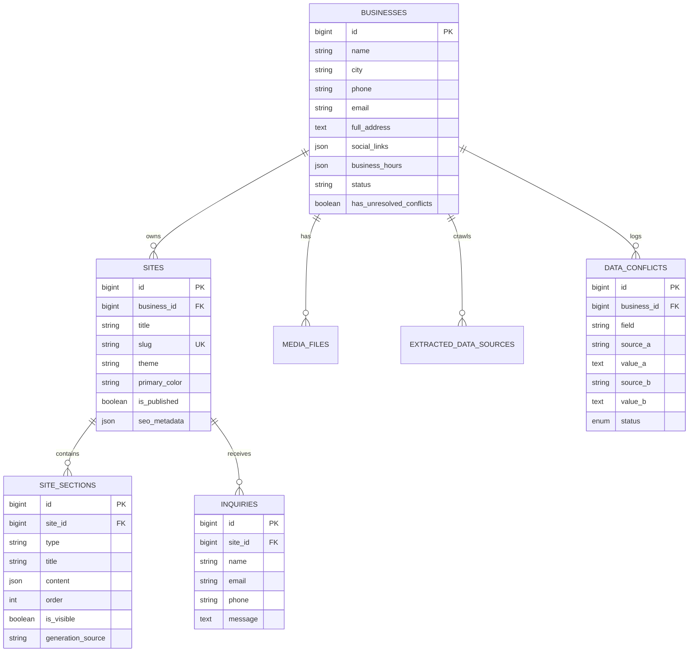

# AI Builds My Website

> **Turn any business's raw information into a ready-to-publish website using Laravel, MySQL, and Google Gemini AI.**  
> Built as an assignment submission for the **Full Stack Development Internship at Websites.co.in**.  
> **Repository:** [https://github.com/rajkushwahapvt-design/forage.aI](https://github.com/rajkushwahapvt-design/forage.aI)

---

## Overview

Small business owners often have scattered digital footprints: a Google Business listing, an Instagram page, a PDF price list, or a few photos, but lack the technical expertise to build an integrated website.

**"AI Builds My Website"** bridges this gap:
1. **Intake:** The business owner supplies any mix of business name, city, Google Maps listing, social links, or file uploads (PDF brochures, menus, CSV price lists, photos).
2. **Extract & Verify:** The system crawls public listings, parses PDF/CSV files, extracts factual services and contact information, and detects discrepancies between sources.
3. **Generate:** Google Gemini 1.5 Flash (with graceful deterministic fallback) synthesizes the verified facts into a complete, modern, mobile-responsive website.
4. **Edit & Regenerate:** The user can customize styles, edit content directly, regenerate any individual section with natural language prompts, and publish to a live public URL.
5. **Capture Leads:** The published website includes an inquiry form that saves customer leads directly into MySQL.

---

## Core Features

- **Multi-Source Ingestion:** Accepts names, cities, Google Business URLs, Instagram/Facebook/LinkedIn profiles, PDF brochures, CSV price lists, and photos.
- **Strict Golden Rule Enforcement:** *Never hallucinate facts.* Phone numbers, addresses, and prices are only populated if verified; missing data is flagged for user confirmation.
- **Section Re-generation:** Regenerate specific sections (Hero, About, Services, Reviews) using custom AI prompts without altering the rest of the site.
- **Disambiguation Engine:** Detects and handles multiple businesses sharing the same name by evaluating city and address confidence scores.
- **Source Conflict Resolution:** Automatically identifies when two sources disagree (e.g., differing phone numbers between a brochure and Google listing) and displays an interactive resolution bar.
- **Anti-Scraping Resilience:** Gracefully catches social media bot-blocks (HTTP 403/429/999) without crashing, falling back to OpenGraph metadata or manual prompts.
- **Indirect Prompt Injection Defense:** Sanitizes uploaded documents, strips instruction overrides, bounds context length, and enforces XML delimiters.
- **Zero-Downtime Fallback:** If the Gemini API is unavailable or rate-limited, the system falls back to a deterministic, high-standard template generator.
- **Public Publishing & Lead Management:** 1-click toggle between Draft and Published at `/site/{slug}`, with customer inquiries stored in MySQL.

---

## Tech Stack

- **Backend Framework:** Laravel 11 (PHP 8.2+)
- **Database:** MySQL
- **AI Model:** Google Gemini 1.5 Flash (via Generative Language API) / Gemini 1.5 Pro
- **HTTP & Crawling:** Guzzle HTTP Client
- **Document Parsing:** Smalot PDF Parser & Native ASCII text stream extractor
- **Frontend:** Blade, Tailwind CSS, FontAwesome 6, Google Fonts

---

## Database Architecture (MySQL)



---

## Quickstart Guide

### 1. Prerequisites
- PHP >= 8.2
- Composer
- MySQL Server (or SQLite for quick evaluation)

### 2. Setup Repository & Dependencies
```bash
# Clone the repository
git clone https://github.com/rajkushwahapvt-design/forage.aI.git
cd forage.aI

# Copy environment file
cp .env.example .env

# Install Composer dependencies
composer install

# Generate application key
php artisan key:generate
```

### 3. Configure `.env`
Edit `.env` to configure your MySQL connection and optional Gemini API Key:
```ini
DB_CONNECTION=mysql
DB_HOST=127.0.0.1
DB_PORT=3306
DB_DATABASE=ai_website_builder
DB_USERNAME=root
DB_PASSWORD=

# Get a free Gemini key at: https://aistudio.google.com/app/apikey
GEMINI_API_KEY=your_gemini_api_key_here
GEMINI_MODEL=gemini-1.5-flash
```
*(Note: If no API key is provided, the application runs seamlessly using the built-in `TemplateFallbackGenerator`.)*

### 4. Run Migrations & Storage Link
```bash
php artisan migrate
php artisan storage:link
```

### 5. Launch the Server
```bash
php artisan serve
```
Open **`http://localhost:8000`** in your browser.

---

## Key Endpoints & Routes

| Method | Endpoint | Description |
|---|---|---|
| `GET` | `/` | Intake wizard where business owner provides inputs / files |
| `POST` | `/build` | Crawls links, parses files, detects conflicts, generates website |
| `GET` | `/editor/{site}` | Live visual editor with section manager and theme controls |
| `POST` | `/business/{business}/resolve-conflict` | Resolves conflicting data between sources |
| `POST` | `/api/section/{section}/update` | Updates section title/JSON content |
| `POST` | `/api/section/{section}/regenerate` | Regenerates single section with AI prompt |
| `POST` | `/api/site/{site}/publish` | Toggles Draft / Published state |
| `GET` | `/site/{slug}` | Public, responsive website for visitors |
| `POST` | `/site/{slug}/inquiry` | Lead inquiry submission from public site |

---

## Edge Cases Handled

1. **Multiple Businesses with the Same Name:** Disambiguation scoring checks city and category matches.
2. **Sources that Disagree:** Flags conflicting data (e.g. differing phone numbers between Google Maps and uploaded PDF) in the database and shows a 1-click resolution bar.
3. **Social Networks Blocking Crawlers:** Catches HTTP 403/429 gracefully and uses OpenGraph meta fallbacks.
4. **Indirect Prompt Injection:** Neutralizes prompt override directives (e.g., `"ignore all previous instructions"`) embedded in uploaded files using regex sanitization and strict XML encapsulation.
5. **AI Downtime:** Seamlessly transitions to deterministic fallback templates if Gemini API fails or runs out of quota.

---

## License

MIT License. Designed and developed for the Websites.co.in internship evaluation.
